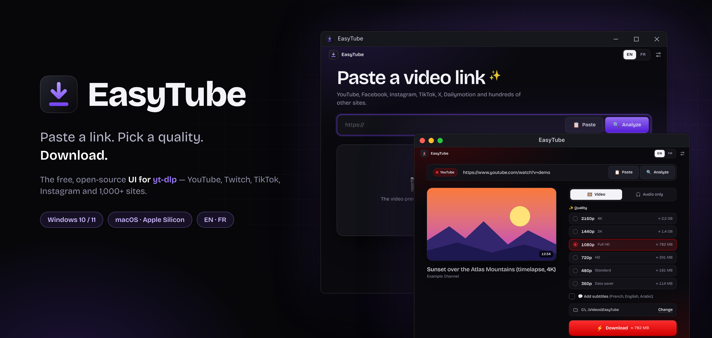
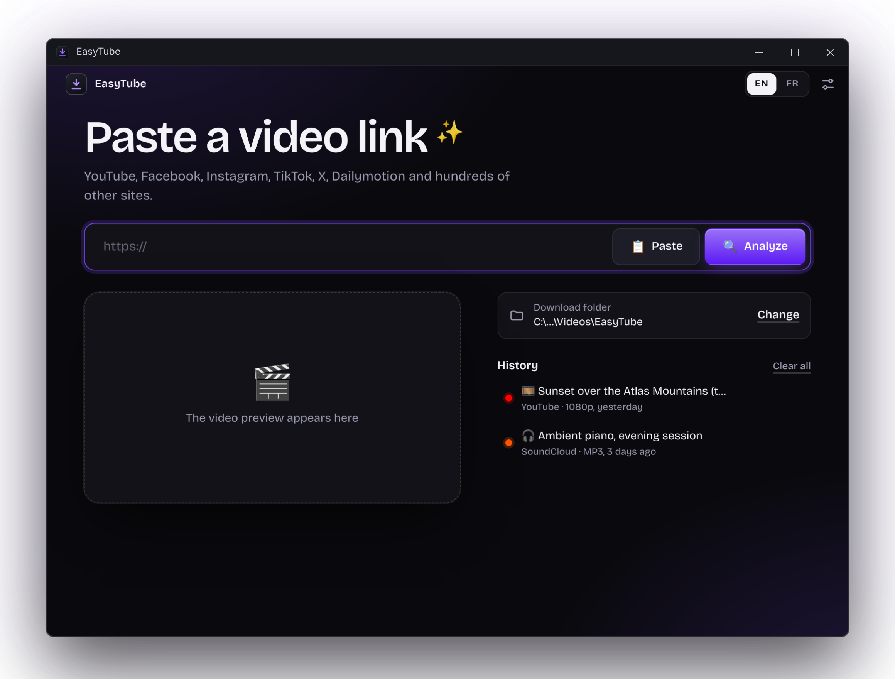
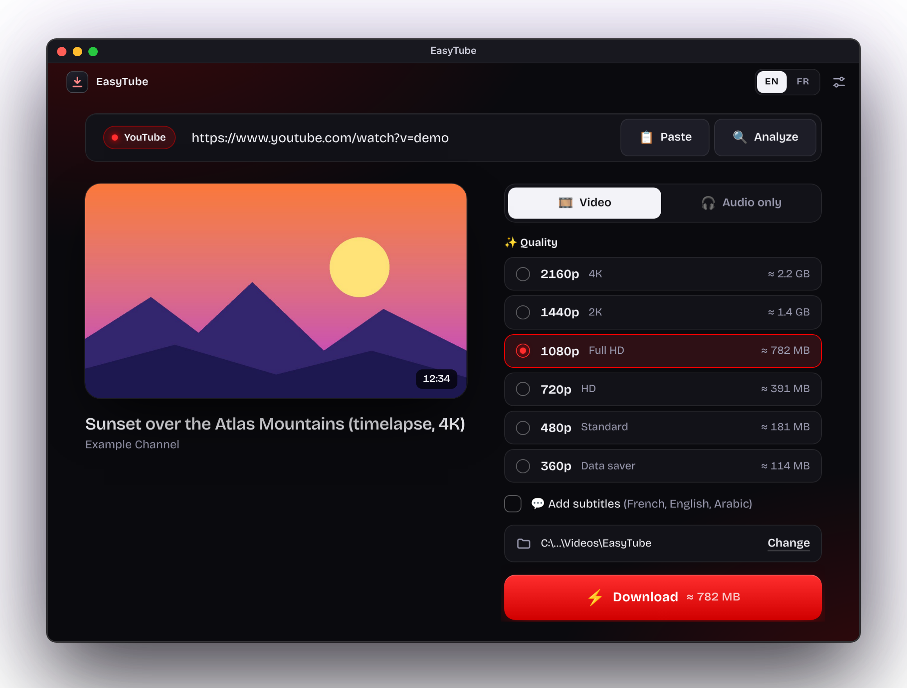
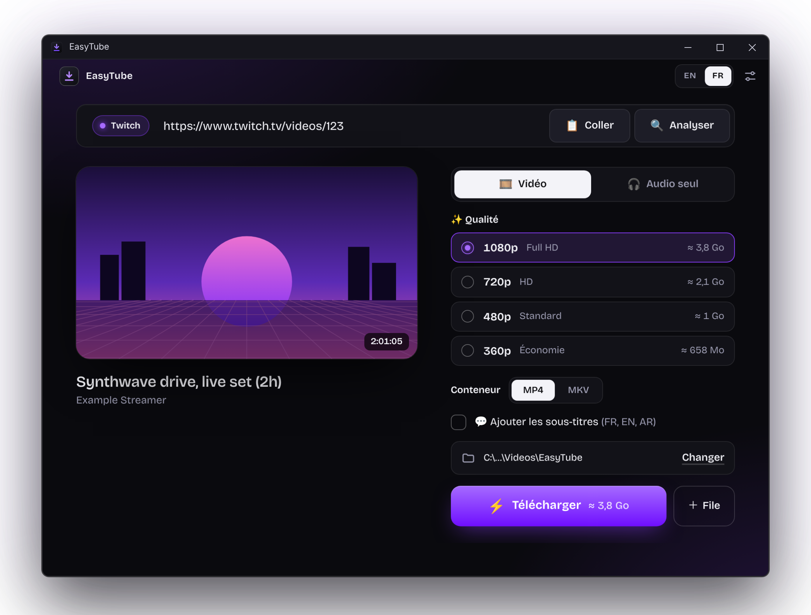

<p align="center">
  
</p>

<h1 align="center">EasyTube</h1>

<p align="center">
  <b>The free, open-source graphical interface (UI) for <a href="https://github.com/yt-dlp/yt-dlp">yt-dlp</a>, on Windows and macOS.</b><br>
  yt-dlp is the most powerful video downloader, but it only works in the command line.<br>
  EasyTube turns it into a simple, modern app: paste a link, pick a quality, download.
</p>

<p align="center">
  <a href="https://github.com/BlackStar798/easytube/releases/latest"></a>
  <a href="https://github.com/BlackStar798/easytube/releases"></a>
  
  <a href="LICENSE"></a>
</p>

<p align="center">
  <a href="https://github.com/BlackStar798/easytube/releases/latest"><b>⬇️ Download</b></a> &nbsp;·&nbsp;
  <a href="https://blackstar798.github.io/easytube/"><b>🌐 Website</b></a> &nbsp;·&nbsp;
  <a href="#-français"><b>🇫🇷 Version française</b></a>
</p>

<p align="center">
  
  
</p>

## Features

- **Paste a link, see the preview** (title, thumbnail, duration) and the **real list of available qualities** with estimated file sizes, up to 4K / 8K when the video has them.
- **Video or audio only** (MP3 or M4A), **MP4 or MKV** output (MKV keeps the best codecs above 1080p), optional **subtitles** in the languages you choose.
- **Playlists**: tick the videos you want, or take them all; each playlist goes into its own folder, numbered.
- **Queue**: paste several links at once (one per line); they download one after the other, and you can add more while one is running.
- **Clear progress**: video title, percentage, speed, time left, merging step; cancel at any time; system notification and a small sound when it is done.
- **Link history** (last 10): click a row to download it again, copy the link, show the file in its folder.
- **Dynamic theme**: the app takes the colors of the site you paste (YouTube red, Twitch purple…), or your own accent color.
- **English and French**, switch in one click (top right). Keyboard shortcuts: `Ctrl+V` paste, `Ctrl+L` focus the link bar, `Ctrl+Enter` start, `Ctrl+,` settings (`⌘` instead of `Ctrl` on a Mac).
- **Friendly errors**: each failure comes with a clear explanation and what to try (age check, bot check, private video, no space left…).
- **Works with YouTube today**: YouTube now needs a JavaScript engine; EasyTube provides one itself (it uses the engine already inside the app, tested at startup, with a safe fallback).
- **Safe engine updates**: you decide when to update yt-dlp; the official file is verified with its SHA-256 checksum before it is used.
- **Sign-in options** for members-only or age-restricted videos: read cookies from Firefox, Edge, Chrome or Brave (and Safari on a Mac), or use a `cookies.txt` file.
- **Advanced** (Settings): speed limit, proxy, subtitle languages, YouTube helper on/off; automatic update checks can be turned off too. **About** has a "Copy diagnostics" button for bug reports.
- **Windows**: installs for **your user only** (no administrator rights); installing a new version over the old one **keeps your settings and history**.
- **macOS**: a normal Mac app (drag it to *Applications*), native menu bar and `⌘` shortcuts, Apple Silicon.

## Install

### Windows

1. Go to the **[Releases](https://github.com/BlackStar798/easytube/releases/latest)** page and download `EasyTube-Setup-x.y.z.Win.zip`.
2. Unzip it and run `EasyTube-Setup-x.y.z.exe`.
3. Requires **Windows 10 or 11 (64-bit)**.

The installer is **not code-signed**, so Windows SmartScreen or an antivirus may warn about it ("More info → Run anyway").
Every release lists the **SHA-256** of the installer: you can compare it with the one you get (`certutil -hashfile EasyTube-Setup-x.y.z.exe SHA256`) or check the file on [VirusTotal](https://www.virustotal.com).

### macOS

1. Go to the **[Releases](https://github.com/BlackStar798/easytube/releases/latest)** page and download `EasyTube-x.y.z-Mac-Arm64.zip` (Apple Silicon: M1 or newer).
2. Unzip it, open `EasyTube-x.y.z-mac-arm64.dmg` and drag **EasyTube** onto **Applications**.
3. Requires **macOS 13.0 or newer** on an Apple Silicon Mac.

The app is **not notarized by Apple** (that needs a paid developer account), so the **first time** macOS refuses to open it ("Apple could not verify…"). It is a one-time step:
open **System Settings → Privacy & Security**, scroll down to the message about *EasyTube* and click **Open Anyway**, then confirm.
(Terminal alternative: `xattr -dr com.apple.quarantine /Applications/EasyTube.app`.)
Compare the **SHA-256** of the download with the one listed in the release (`shasum -a 256 EasyTube-x.y.z-Mac-Arm64.zip`) if you want to be sure. To uninstall, drag EasyTube to the Trash (your settings are in `~/Library/Application Support/EasyTube`).

## Privacy

EasyTube has no account, no analytics and no telemetry in its code. It talks to the network only in these cases:
- yt-dlp contacts the website of the video you ask for (and the thumbnail is loaded from that site);
- once every 12 hours at most, EasyTube reads the number of the latest yt-dlp version on github.com, and, if the project page is configured, the latest EasyTube version (nothing is installed without your click; **Settings → Download engine → Look for new versions automatically** turns this off);
- when you click "Check for updates", it downloads the new yt-dlp from github.com.

If you use a proxy, a browser sign-in or a `cookies.txt` file, they are only passed to yt-dlp on your computer.
Your settings and link history stay on your computer: in the `data` folder inside the install folder on Windows, in `~/Library/Application Support/EasyTube` on a Mac.

## Build from source

You need Node.js 22+ and npm. See **[docs/BUILDING.md](docs/BUILDING.md)** for the full steps.

```bash
npm install
npm run fetch-binaries   # downloads yt-dlp and FFmpeg/FFprobe for your system (resources/bin or resources/bin-mac-<arch>)
npm start                # run the app in development
npm run check            # check the translation files
npm test                 # automated tests
npm run dist:mac         # macOS only: build the .dmg and .zip (see docs/BUILDING.md)
```

## Changelog

What changed in each version: **[CHANGELOG.md](CHANGELOG.md)** (English and French).

## Contributing

Bug reports, translations and pull requests are welcome: see **[CONTRIBUTING.md](CONTRIBUTING.md)**.

## License and credits

EasyTube's own code is under the **[MIT License](LICENSE)**.
It includes other people's work, each under its own license: **yt-dlp** (Unlicense; GPL-3.0+ for the `.exe` build),
**FFmpeg** (GPL-3.0), **Electron** (MIT) and the **Bricolage Grotesque** font (SIL OFL 1.1).
Details, versions and source links: **[THIRD_PARTY_NOTICES.md](THIRD_PARTY_NOTICES.md)**; full texts in [`licenses/`](licenses/).

A big thank you to the yt-dlp and FFmpeg contributors: without them, EasyTube would not exist.
EasyTube was created with the help of [Claude Code](https://claude.com/claude-code).

## Please use it responsibly

EasyTube is for **personal use**. Respect copyright and the terms of use of each website.
It is an independent project, not affiliated with or endorsed by yt-dlp, YouTube or any other site.

---

## 🇫🇷 Français

**EasyTube est l'interface graphique (UI) gratuite et open source pour [yt-dlp](https://github.com/yt-dlp/yt-dlp), sur Windows et macOS.**
yt-dlp est le téléchargeur de vidéos le plus puissant, mais il ne s'utilise qu'en ligne de commande. EasyTube en fait une appli simple et moderne : colle un lien, choisis une qualité, télécharge.
yt-dlp et FFmpeg sont déjà inclus : rien d'autre à installer. **[Télécharger](https://github.com/BlackStar798/easytube/releases/latest)** · **[Site web](https://blackstar798.github.io/easytube/)**

<p align="center">
  
</p>

### Fonctionnalités

- **Colle un lien, vois l'aperçu** (titre, miniature, durée) et la **vraie liste des qualités disponibles** avec la taille estimée, jusqu'à la 4K / 8K quand la vidéo les propose.
- **Vidéo ou audio seul** (MP3 ou M4A), sortie **MP4 ou MKV** (le MKV garde les meilleurs codecs au-delà de 1080p), **sous-titres** en option dans les langues de ton choix.
- **Playlists** : coche les vidéos voulues, ou prends tout ; chaque playlist va dans son propre dossier, numérotée.
- **File d'attente** : colle plusieurs liens d'un coup (un par ligne) ; ils se téléchargent l'un après l'autre, et tu peux en ajouter pendant un téléchargement.
- **Progression claire** : titre de la vidéo, pourcentage, vitesse, temps restant, étape d'assemblage ; annulation à tout moment ; notification système et petit son à la fin.
- **Historique des liens** (10 derniers) : un clic pour re-télécharger, copier le lien, afficher le fichier dans son dossier.
- **Thème dynamique** : l'appli prend les couleurs du site collé (rouge YouTube, violet Twitch…), ou ta couleur préférée.
- **Français et anglais**, changement en un clic (en haut à droite). Raccourcis : `Ctrl+V` coller, `Ctrl+L` aller à la barre de lien, `Ctrl+Entrée` lancer, `Ctrl+,` réglages (`⌘` à la place de `Ctrl` sur Mac).
- **Erreurs expliquées** : chaque échec vient avec une explication claire et une piste pour s'en sortir (âge, robot, vidéo privée, disque plein…).
- **Compatible YouTube aujourd'hui** : YouTube exige désormais un moteur JavaScript ; EasyTube en fournit un lui-même (il utilise celui déjà présent dans l'appli, testé au démarrage, avec un repli sûr).
- **Mises à jour du moteur sous ton contrôle** : tu décides quand mettre à jour yt-dlp ; le fichier officiel est vérifié par sa signature SHA-256 avant utilisation.
- **Connexion** pour les vidéos réservées aux abonnés ou aux adultes : cookies de Firefox, Edge, Chrome ou Brave (et Safari sur Mac), ou fichier `cookies.txt`.
- **Avancé** (Réglages) : limite de vitesse, proxy, langues des sous-titres, aide YouTube activable ou non ; les vérifications automatiques de mises à jour peuvent aussi être désactivées. **À propos** a un bouton « Copier le diagnostic » pour les rapports de bug.
- **Windows** : installation **pour ton compte uniquement** (sans droits administrateur) ; installer une nouvelle version par-dessus l'ancienne **garde tes réglages et ton historique**.
- **macOS** : une vraie app Mac (glisse-la dans *Applications*), barre de menus native et raccourcis `⌘`, Apple Silicon.

### Installation

#### Windows

1. Va sur la page **[Releases](https://github.com/BlackStar798/easytube/releases/latest)** et télécharge `EasyTube-Setup-x.y.z.Win.zip`.
2. Décompresse-le et lance `EasyTube-Setup-x.y.z.exe`.
3. Nécessite **Windows 10 ou 11 (64 bits)**.

L'installateur **n'est pas signé numériquement** : SmartScreen ou un antivirus peut donc le signaler (« Informations complémentaires → Exécuter quand même »).
Chaque version indique l'empreinte **SHA-256** de l'installateur : compare-la à la tienne (`certutil -hashfile EasyTube-Setup-x.y.z.exe SHA256`) ou fais analyser le fichier sur [VirusTotal](https://www.virustotal.com).

#### macOS

1. Va sur la page **[Releases](https://github.com/BlackStar798/easytube/releases/latest)** et télécharge `EasyTube-x.y.z-Mac-Arm64.zip` (Apple Silicon : M1 ou plus récent).
2. Décompresse-le, ouvre `EasyTube-x.y.z-mac-arm64.dmg` et glisse **EasyTube** sur **Applications**.
3. Nécessite **macOS 13.0 ou plus récent** sur un Mac Apple Silicon.

L'app **n'est pas notarisée par Apple** (cela demande un compte développeur payant) : **la première fois**, macOS refuse donc de l'ouvrir (« Apple n'a pas pu vérifier… »). C'est à faire une seule fois :
ouvre **Réglages Système → Confidentialité et sécurité**, descends jusqu'au message qui parle d'*EasyTube* et clique sur **Ouvrir quand même**, puis confirme.
(Variante Terminal : `xattr -dr com.apple.quarantine /Applications/EasyTube.app`.)
Compare l'empreinte **SHA-256** du téléchargement à celle indiquée dans la release (`shasum -a 256 EasyTube-x.y.z-Mac-Arm64.zip`) si tu veux être sûr. Pour désinstaller, glisse EasyTube à la corbeille (tes réglages sont dans `~/Library/Application Support/EasyTube`).

### Vie privée

EasyTube n'a ni compte, ni statistiques, ni télémétrie dans son code. Il n'utilise le réseau que dans ces cas :
- yt-dlp contacte le site de la vidéo demandée (la miniature est chargée depuis ce site) ;
- au plus une fois toutes les 12 heures, EasyTube lit le numéro de la dernière version de yt-dlp sur github.com et, si la page du projet est renseignée, celui de la dernière version d'EasyTube (rien n'est installé sans ton clic ; **Réglages → Moteur de téléchargement → Chercher automatiquement les nouvelles versions** désactive cela) ;
- quand tu cliques sur « Vérifier les mises à jour », il télécharge le nouveau yt-dlp depuis github.com.

Si tu utilises un proxy, une connexion via le navigateur ou un fichier `cookies.txt`, ils ne sont transmis qu'à yt-dlp, sur ton ordinateur.
Tes réglages et ton historique restent sur ton ordinateur : dans le dossier `data` du dossier d'installation sous Windows, dans `~/Library/Application Support/EasyTube` sur Mac.

### Compiler depuis les sources

Il faut Node.js 22+ et npm. Les étapes complètes (Windows et macOS, `npm run dist:mac`) sont dans **[docs/BUILDING.md](docs/BUILDING.md)** (en anglais).

### Journal des versions

Les changements de chaque version : **[CHANGELOG.md](CHANGELOG.md)** (français et anglais).

### Licence et crédits

Le code d'EasyTube est sous **[licence MIT](LICENSE)**. Il inclut le travail d'autres personnes, chacun sous sa propre licence :
**yt-dlp** (Unlicense ; GPL-3.0+ pour la version `.exe`), **FFmpeg** (GPL-3.0), **Electron** (MIT) et la police **Bricolage Grotesque** (SIL OFL 1.1).
Détails, versions et liens vers le code source : **[THIRD_PARTY_NOTICES.md](THIRD_PARTY_NOTICES.md)** ; textes complets dans [`licenses/`](licenses/).

Un grand merci aux contributeurs de yt-dlp et de FFmpeg : sans eux, EasyTube n'existerait pas.
EasyTube a été créé avec l'aide de [Claude Code](https://claude.com/claude-code).

### Usage responsable

EasyTube est prévu pour un **usage personnel**. Respecte le droit d'auteur et les conditions d'utilisation de chaque site.
C'est un projet indépendant, non affilié à yt-dlp, YouTube ou tout autre site, et non approuvé par eux.
